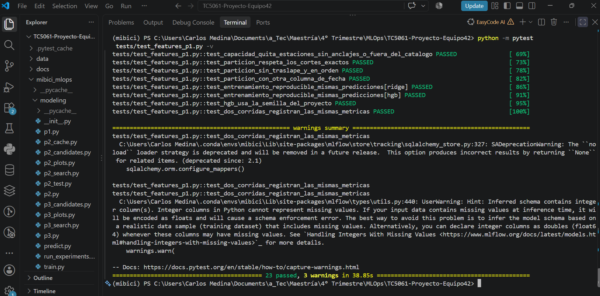
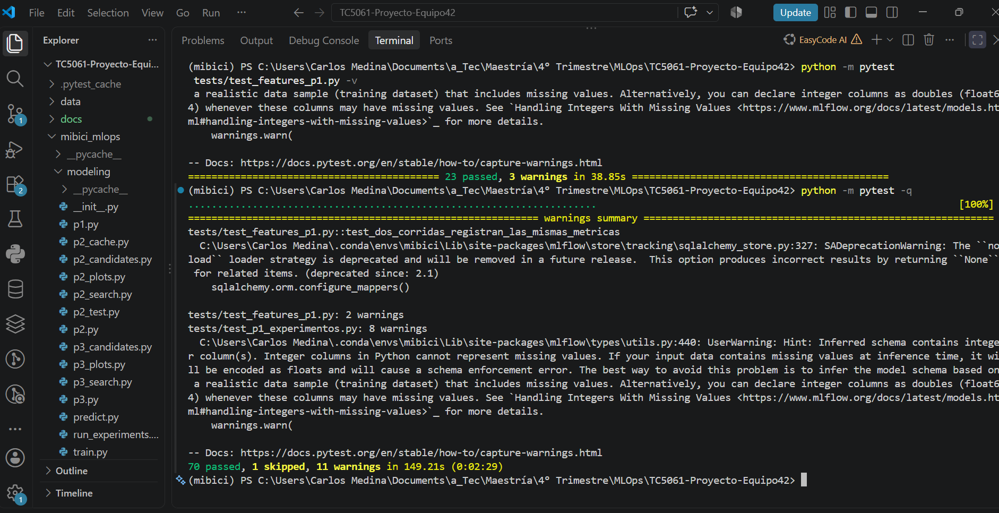
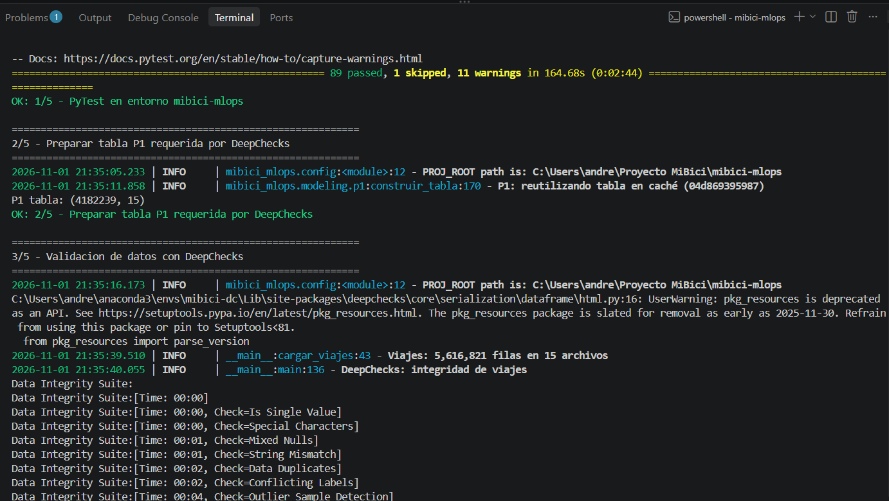
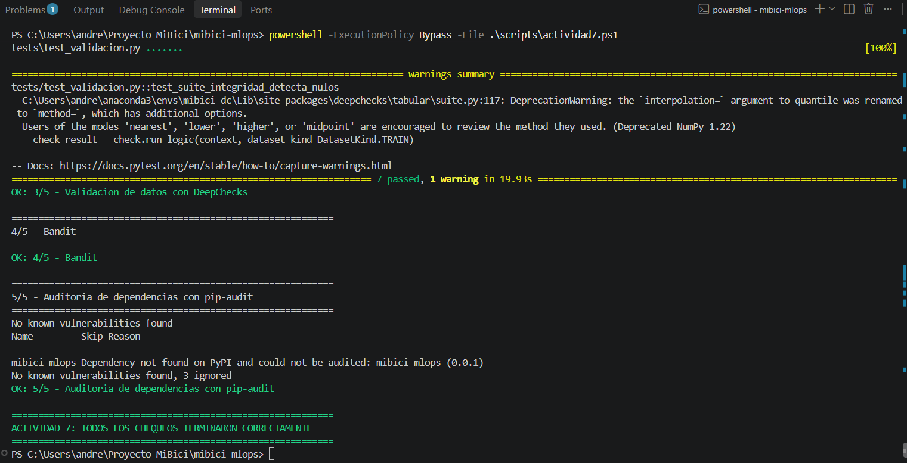

# MiBici MLOps · TC5061 Equipo 42

<a target="_blank" href="https://cookiecutter-data-science.drivendata.org/">
    
</a>

Pipeline reproducible de Machine Learning sobre los datos abiertos de **MiBici**, el sistema de bicicleta pública del Área Metropolitana de Guadalajara. Primera entrega del proyecto integrador de TC5061 Operaciones de Aprendizaje Automático (Tecnológico de Monterrey).

## Propósito

Responder con Machine Learning tres preguntas sobre la operación de MiBici y dejar una base reproducible: ingesta versionada, variables sin información del futuro, baselines registrados en MLflow y un flujo de trabajo en equipo con Pull Requests. La propuesta completa está en el ML Canvas ([`references/ml_canvas.md`](references/ml_canvas.md)) y la arquitectura en [`references/arquitectura.png`](references/arquitectura.png).

## Preguntas del proyecto

| # | Pregunta | Tarea | Formulación | Usuario |
|---|---|---|---|---|
| P1 | ¿Cuántos viajes iniciarán en una estación en la siguiente hora? | Regresión | Salidas por estación × hora, horizonte 1 h | Operador del sistema |
| P2 | ¿La estación se quedará sin bicis o sin anclajes? | Clasificación (3 clases) | Flujo neto de la hora / capacidad: < −0.30 desabasto, > +0.30 saturación; horizonte 1 h | Equipo de rebalanceo |
| P3 | ¿Qué grupos de estaciones comparten patrones de uso? | Clustering | Perfil horario de salidas y llegadas (entre semana y fin de semana) + flujo neto relativo | Planeación urbana |

## Datos

- **Fuente:** [portal de datos abiertos de MiBici](https://www.mibici.net/es/datos-abiertos/): viajes mensuales en CSV y nomenclatura de estaciones (`nomenclatura_2026_09.csv`). Las URLs exactas de cada mes están en `mibici_mlops/config.py`.
- **Rango:** 15 meses, de julio de 2025 a septiembre de 2026 → **5,616,821 viajes** (tras eliminar 758 duplicados) y **484 estaciones**.
- **Partición temporal:** entrenamiento jul-2025 a mar-2026 · validación abr a jun-2026 · test jul a sep-2026 (fechas de corte en `config.py`).
- **Versionado:** `data_manifest.json` (en Git) guarda número de registros y SHA-256 de cada archivo crudo y procesado; su hash es el `data_version` que se registra en MLflow.
- **Datos personales:** la ingesta solo lee 5 columnas (viaje, inicio, fin, origen, destino); `Usuario_Id`, `Genero` y `Año_de_nacimiento` nunca se leen ni se guardan.
- **Uso:** el portal no publica una licencia abierta explícita; los datos se usan con fines académicos y **no se redistribuyen** (están en `.gitignore`; se descargan con `make data`).

## Estructura del repositorio

```
├── MLproject                <- MLflow Project: puntos de entrada ingest y train
├── python_env.yaml          <- Entorno del MLflow Project (mismas versiones que requirements.txt)
├── Makefile                 <- make requirements | data | experiments | test | lint
├── README.md
├── data_manifest.json       <- Versión de los datos (registros + SHA-256 por archivo)
├── pyproject.toml           <- Metadatos del paquete mibici_mlops y configuración de ruff
├── requirements.txt         <- Dependencias con versión fija (Python 3.12)
├── data/                    <- Fuera de Git: raw/ (CSV originales) y processed/ (Parquet)
├── docs/                    <- Proyecto mkdocs de la plantilla
├── models/                  <- Modelos serializados (fuera de Git)
├── notebooks/               <- Solo exploración: 1.0-ce-exploracion-mibici.ipynb
├── references/              <- ML Canvas (md, png, html) y diagrama de arquitectura (png, dot)
├── reports/figures/         <- Figuras generadas por los experimentos (fuera de Git)
├── tests/                   <- Pruebas de ingesta, features de P3, modelo P2 y registro común / MLflow Project (pytest)
└── mibici_mlops/            <- Código fuente
    ├── config.py            <- Rutas, fechas, partición, semilla, URLs y MLflow (un solo lugar)
    ├── dataset.py           <- Ingesta: descarga, normalización y Parquet
    ├── manifest.py          <- Genera data_manifest.json
    ├── features.py          <- Tabla estación × hora, calendario, rezagos, etiqueta P2, perfiles P3
    ├── tracking.py          <- Registro común en MLflow: registrar_run (baselines), iniciar_run + registrar_resultados (candidatos)
    ├── preparar_p2.py, modelo_p2.py, entrenar_p2.py   <- Preparación, modelo y entrenamiento de P2
    └── modeling/
        ├── p1.py, p2.py, p3.py      <- main() (baseline) y train(model, params) (candidatos, entrega 2)
        ├── train.py                 <- Punto de entrada train del MLflow Project
        └── run_experiments.py       <- Orquesta P1, P2 y P3 (make experiments)
```

## Instalación

Requiere Python 3.12, `make` y `curl`.

```bash
git clone https://github.com/a01797754-dotAPML/TC5061-Proyecto-Equipo42.git
cd TC5061-Proyecto-Equipo42
conda create -n mibici python=3.12 -y && conda activate mibici   # o un venv con Python 3.12
make requirements                                                # instala dependencias fijas + el paquete
```

## Ingesta de datos

```bash
make data
```

Descarga los 15 meses y la nomenclatura, normaliza codificación, columnas y fechas, elimina duplicados, guarda Parquet en `data/processed/` y regenera `data_manifest.json`. Desde un clon limpio, el manifiesto resulta idéntico al versionado (`data_version = 2a196cfa2823`).

## Experimento base

```bash
make experiments                                                # P1, P2 y P3 → experimento mibici-equipo42
python -m mibici_mlops.modeling.run_experiments --pregunta P2   # una sola pregunta (repetible)
python -c "from mibici_mlops.modeling import p3; p3.main_pca()" # candidato P3: PCA + KMeans
python -m mlflow ui --backend-store-uri sqlite:///mlflow.db     # interfaz en http://127.0.0.1:5000
```

`make experiments` se niega a correr con cambios sin commitear (salvo `--permitir-cambios`), sigue con las demás preguntas si una falla y termina con código 1 si hubo errores. Usar `python -m mlflow` garantiza la versión de MLflow del entorno.

| Run | Métricas de test |
|---|---|
| `p1-baseline-semana-anterior` | MAE 0.942 · RMSE 1.921 |
| `p2-baseline-semana-anterior` | macro-F1 0.473 · recall desabasto 0.182 · recall saturación 0.243 |
| `p2-random-forest` | macro-F1 0.512 · recall desabasto 0.382 · recall saturación 0.458 |
| `p3-baseline-kmeans` | silhouette 0.074 · Davies-Bouldin 3.05 · ARI 0.686 |
| `p3-pca-kmeans` | silhouette 0.095 · Davies-Bouldin 2.72 · ARI 0.633 |

Pruebas: `make test` (o `python -m pytest tests`).

## MLflow Project (entrega 2)

El repositorio es un **MLflow Project** (`MLproject` en la raíz): la ingesta y el entrenamiento de P1, P2 y P3 se ejecutan con `mlflow run`. El entorno se declara en `python_env.yaml` con las mismas versiones fijas de `requirements.txt`; `mlflow run` lo crea con **pyenv** (`brew install pyenv && pyenv install 3.12.15`).

### 1. Servidor de tracking (requerido por el Model Registry)

En una terminal aparte, desde la raíz del repo:

```bash
python -m mlflow server --backend-store-uri sqlite:///mlflow.db --port 5000
```

Y en la terminal de trabajo:

```bash
export MLFLOW_TRACKING_URI=http://127.0.0.1:5000
```

`config.py` toma `MLFLOW_TRACKING_URI` de esta variable (si no existe, usa `sqlite:///mlflow.db`). `mlflow.db`, `mlruns/` y `mlartifacts/` están en `.gitignore`. Usar `python -m mlflow` garantiza la versión de MLflow del entorno.

### 2. Ingesta y entrenamiento con `mlflow run`

```bash
# Ingesta: descarga, normaliza y versiona los datos (dataset.py + manifest.py)
python -m mlflow run . -e ingest --experiment-name mibici-equipo42

# Entrenamiento de un candidato: pregunta, modelo e hiperparámetros (JSON)
python -m mlflow run . -e train --experiment-name mibici-equipo42 \
    -P question=<p1|p2|p3> -P model=<modelo> -P params='{"<hiperparametro>": <valor>}'
```

| Parámetro | Valores | Por defecto |
|---|---|---|
| `question` | `p1`, `p2`, `p3` | `p1` |
| `model` | Los que implementa cada `modeling/pN.py` | Obligatorio |
| `params` | Hiperparámetros en JSON | `{}` (valores por defecto del modelo) |

Rutas, fechas, partición y semilla salen de `config.py`; no se pasan por parámetro. Para probar sin MLflow Project: `python -m mibici_mlops.modeling.train --question <p1|p2|p3> --model <modelo>`.

**Contrato por pregunta:** cada `mibici_mlops/modeling/pN.py` expone `train(model: str, params: dict) -> str` (devuelve el `run_id`) y registra la corrida con `tracking.iniciar_run` + `tracking.registrar_resultados`. El ejemplo de uso completo está en `tests/test_mlflow_project.py`.

### 3. Qué registra cada candidato

Cada corrida candidata reutiliza el run que crea `mlflow run` y registra, con el helper común `tracking.iniciar_run` + `tracking.registrar_resultados`:

| Elemento | Dónde |
|---|---|
| Etiquetas `equipo`, `question`, `git_commit`, `git_cambios_sin_commit`, `model_family`, `stage_of_work` (`baseline`, `search`, `candidate`) | Tags del run |
| Fechas de la partición, `data_version`, `seed` e hiperparámetros | Parámetros del run |
| Métricas `val_*` y `test_*` (las mismas de la entrega 1) y la mejora contra el baseline | Métricas del run |
| Modelo con firma (`signature`) y ejemplo de entrada | *Logged model* `model`, ligado al run |
| Manifiesto de datos | `data/data_manifest.json` |
| Conjunto de entrenamiento **agregado** (estación × hora) | Input del run (`mlflow.log_input`) |
| Gráficas de desempeño | `plots/` |
| Configuración de la corrida | `config/run_config.json` |

Las búsquedas de hiperparámetros se organizan como **nested runs**: un run padre (`stage_of_work=search`) y un run hijo por combinación (`iniciar_run(..., nested=True)`).

### 4. Model Registry

Esquema de ciclo de vida: **aliases** (el esquema vigente de MLflow; las etapas *Staging/Production* están obsoletas). `champion` marca la versión en producción y `challenger` la siguiente mejor. Modelos:

| Pregunta | Modelo registrado | Carga en producción |
|---|---|---|
| P1 | `mibici-equipo42-p1-demanda` | `models:/mibici-equipo42-p1-demanda@champion` |
| P2 | `mibici-equipo42-p2-riesgo` | `models:/mibici-equipo42-p2-riesgo@champion` |
| P3 | `mibici-equipo42-p3-grupos` | `models:/mibici-equipo42-p3-grupos@champion` |

Al registrar cada versión se copian `git_commit` y `data_version` del run como tags de la versión, para que el linaje se vea en la página del modelo.

### 5. Reproducir la experimentación completa (corrida oficial)

Con el servidor de tracking arriba y `MLFLOW_TRACKING_URI` apuntando a él, desde un clon limpio. El **orden importa** en P1: `hgb-final` toma la mejor combinación de la última `p1-hgb-search`.

```bash
python -m mlflow run . -e ingest --experiment-name mibici-equipo42

for m in baseline ridge hgb hgb-squared hgb-search hgb-final; do
  python -m mlflow run . -e train --experiment-name mibici-equipo42 -P question=p1 -P model=$m
done
for m in baseline rf-ajustado-1 rf-ajustado-2 rf-ajustado-3 rf-search; do
  python -m mlflow run . -e train --experiment-name mibici-equipo42 -P question=p2 -P model=$m
done
python -m mibici_mlops.modeling.p2_test   # evalúa en test el ganador de p2-rf-search (sin reentrenar)
for m in baseline kmeans-sin-escalar kmeans-flujo-escalado pca-flujo-escalado kmeans-search; do
  python -m mlflow run . -e train --experiment-name mibici-equipo42 -P question=p3 -P model=$m
done
```

Ninguna corrida necesita `params`: los valores por defecto y las mallas de búsqueda están en cada `modeling/pN*.py`.

**Windows:** `mlflow run` escapa dos veces las comillas al pasar el comando a `cmd`, así que cualquier `-P params` con JSON falla (`Invalid \escape`). Usar `--env-manager local` y los comandos sin `params`.

**Cachés:** P1 (`data/interim`) y P2 (`data/processed/p2_cache`) guardan sus tablas ligadas al `data_version`. Si cambia el código de features sin cambiar los datos, borrar la caché antes de correr.

## Buenas prácticas aplicadas

| Práctica | Cómo la aplicamos |
|---|---|
| Un experimento, runs con nombre descriptivo | Experimento `mibici-equipo42`; nombres como `p2-random-forest`, nunca aleatorios |
| Parámetros para reproducir | `registrar_run` agrega siempre fechas, `val_inicio`, `test_inicio`, `data_version` y `seed`; cada pregunta agrega su modelo e hiperparámetros |
| Run ligado a código y pregunta | Tags `equipo`, `pregunta`, `git_commit` y `git_cambios_sin_commit` |
| Métricas con el conjunto en el nombre | `registrar_run` rechaza métricas sin prefijo `train_`, `val_` o `test_` |
| Sin credenciales ni datos personales | La ingesta no lee columnas de usuario; `registrar_run` rechaza parámetros con esos nombres; `.env` en `.gitignore` |
| Notebooks solo para exploración | La lógica vive en `mibici_mlops/`; el notebook sigue la convención `1.0-iniciales-descripcion` |
| Configuración en un solo lugar | `config.py` (rutas, fechas, semilla, URLs, MLflow) |
| Dependencias fijas y entorno reproducible | `requirements.txt` con versiones fijas, verificado en un entorno nuevo desde un clon limpio |
| Nada de datos, modelos ni MLflow en Git | `.gitignore` excluye `data/`, `models/`, `mlruns/`, `mlartifacts/`, `mlflow.db`, `.env` y salidas de `reports/` |
| Cambios a `main` solo por PR revisado | Rama `main` protegida (requiere aprobación) |

## Flujo de trabajo con Git (GitHub Flow)

1. `main` está protegida: nadie hace push directo; todo entra por Pull Request con al menos una aprobación.
2. Cada cambio en su rama, creada desde `main` actualizado: `tipo/descripcion-corta` (por ejemplo `feat/p3-pca-kmeans`, `docs/canvas-p2-visual`, `chore/requirements-versiones`).
3. Commits con [Conventional Commits](https://www.conventionalcommits.org/): `feat`, `fix`, `docs`, `chore`, `refactor`, `test` con alcance opcional, por ejemplo `fix(p2): registrar la matriz de confusión del baseline`.
4. Antes de pedir revisión se trae `main` a la rama y se resuelven conflictos en la rama, no en `main`.
5. Se hace `git status` antes de cada `git add` para no subir datos, modelos ni `mlflow.db`.

## Validaciones de seguridad (Actividad 3)

Se realizó una revisión de seguridad del proyecto MiBici – Equipo 42, incluyendo análisis estático del código, auditoría de dependencias, protección de archivos sensibles y pruebas de regresión.

### 1. Análisis estático con Bandit

Comando ejecutado:

`python -m bandit -r mibici_mlops -f txt`

**Resultados:**
- 11 hallazgos de severidad baja.
- 0 hallazgos de severidad media.
- 0 hallazgos de severidad alta.

Los hallazgos corresponden al uso de `subprocess` en `dataset.py` y `tracking.py`. Se verificó que las llamadas utilizan listas de argumentos sin `shell=True`. Se mantienen como observaciones de baja severidad, principalmente relacionadas con la ejecución de comandos externos y la resolución de ejecutables.

### 2. Auditoría de dependencias con pip-audit

Comando ejecutado:

`python -m pip_audit -r requirements.txt --no-deps`

**Hallazgo inicial:**
- Dependencia afectada: `mlflow==3.17.1`.
- Vulnerabilidad identificada: **CVE-2026-53995**.
- Versión corregida: `mlflow==3.17.2`.

**Acción correctiva:** se actualizó MLflow a la versión 3.17.2 en `requirements.txt` y en el entorno virtual del proyecto.

**Resultado posterior:** `No known vulnerabilities found`.

La configuración documentada utiliza SQLite (`sqlite:///mlflow.db`) como backend de tracking. La actualización se realizó para corregir la dependencia afectada, independientemente de la exposición específica del backend FileStore.

**Limitaciones:** la opción `--no-deps` revisa las dependencias directas auditables, pero no sus dependencias transitivas. El paquete local `mibici-mlops (0.0.1)` fue omitido porque no está disponible en PyPI.

### 3. Protección de credenciales y archivos sensibles

Se verificaron los nombres de los archivos rastreados por Git y se buscaron términos asociados con credenciales en archivos de código y configuración, sin encontrar coincidencias en las comprobaciones realizadas.

Se reforzó `.gitignore` con las siguientes reglas:

- `*.bak`
- `*.pem`
- `*.key`
- `*.p12`
- `*.pfx`
- `credentials.json`

Estas reglas complementan las exclusiones existentes para `.env`, datos locales, modelos y artefactos de MLflow.

Se verificó su funcionamiento mediante `git check-ignore -v`.

Las exclusiones reducen el riesgo de incorporar información sensible accidentalmente, pero no sustituyen una revisión completa de secretos ni eliminan archivos previamente rastreados.

### 4. Pruebas de regresión con PyTest

Comando ejecutado:

`python -m pytest -q`

**Resultados:**
- 47 pruebas aprobadas.
- 0 pruebas fallidas.
- 9 advertencias.
- Tiempo de ejecución: 32.22 segundos.

Las pruebas finalizaron correctamente después de actualizar MLflow a la versión 3.17.2.

### Evidencias de ejecución (Actividad 3)

Las siguientes evidencias se generaron el 30 de octubre de 2026,
utilizando Python 3.12.10 en un entorno virtual local.

| Herramienta | Resultado | Evidencia |
|---|---|---|
| Bandit 1.9.4 | 11 hallazgos bajos, 0 medios y 0 altos | [Ver resultado](docs/security/bandit.txt) |
| pip-audit 2.10.1 | Sin vulnerabilidades conocidas en las dependencias auditadas | [Ver resultado](docs/security/pip-audit.txt) |
| PyTest 9.1.1 | 47 pruebas aprobadas, 9 advertencias | [Ver resultado](docs/security/pytest.txt) |

Los archivos contienen las salidas de las herramientas.
La auditoría con pip-audit se ejecutó con `--no-deps`, por lo que
no incluye dependencias transitivas.

### 5. Conclusión

La revisión permitió identificar y corregir una dependencia con una vulnerabilidad conocida, reforzar la exclusión de archivos potencialmente sensibles y comprobar que los cambios no introdujeron fallos en las pruebas automatizadas existentes.

Los hallazgos de baja severidad de Bandit permanecen documentados para futuras revisiones. Las auditorías realizadas representan controles preventivos y no garantizan la ausencia total de vulnerabilidades.

### Reproducir con `make security`

Las herramientas van en su propio entorno, con versiones fijas en `requirements-security.txt`, para no alterar las dependencias del proyecto.

```bash
conda create -n auditoria python=3.12 -y
conda activate auditoria
pip install -r requirements-security.txt
make security
```

El comando falla si Bandit encuentra hallazgos de severidad media o alta, o si pip-audit encuentra vulnerabilidades, incluidas las de dependencias transitivas. Solo se ignoran las dos de setuptools en `requirements-deepchecks.txt`, documentadas como riesgo aceptado en la auditoría del entorno de DeepChecks.
## Pruebas unitarias de P1 y reproducibilidad del entrenamiento

`tests/test_features_p1.py` prueba las funciones de `mibici_mlops/features.py` que usa P1, con casos normales y casos límite, y verifica que el entrenamiento sea reproducible.

| Función | Caso normal | Casos límite |
|---|---|---|
| `agregar_estacion_hora` | Cuenta salidas, llegadas y flujo neto por estación y hora | Viaje que cruza de hora; horas sin viajes en 0; estación que entra desde su primer viaje; estación que solo recibe llegadas; viajes fuera del rango del proyecto; entrada ya agregada |
| `agregar_calendario` | Hora, día y mes de un lunes | Sábado y domingo marcados como fin de semana |
| `agregar_rezagos` | Valor de la misma estación k horas antes | No se mezclan estaciones; cambiar el futuro no altera los rezagos (sin fuga) |
| `agregar_promedios` | Media de 24 h y de la misma hora en 4 semanas | La media de 24 h excluye la hora que se predice; la de 4 semanas queda vacía sin 4 semanas de historia |
| `agregar_capacidad` | Agrega la capacidad del catálogo | Quita estaciones con capacidad 0 o fuera del catálogo |
| `particion_temporal` | Asigna train, val y test | Cortes exactos en las fechas de `config.py`; sin traslape entre conjuntos |

**Reproducibilidad:** con una tabla sintética construida con las mismas funciones, Ridge y HGB entrenados dos veces dan predicciones idénticas, HGB usa `config.SEED` (42), y dos corridas de `p1.train("hgb")` registran en MLflow las mismas métricas de validación y test con `seed=42`.

**Ejecución** (entorno `mibici`):

- Solo P1: `python -m pytest tests/test_features_p1.py -v`
- Todas las pruebas: `python -m pytest -q` (o `make test`)

**Resultado:** 23 pruebas de P1 aprobadas; en la suite completa, 70 aprobadas y 1 omitida (`test_validacion.py`, que solo corre en el entorno de DeepChecks).






## Validación de datos con DeepChecks

`mibici_mlops/validacion.py` revisa la integridad de los datos procesados y el drift entre train y test de P1 con [DeepChecks](https://docs.deepchecks.com/stable/), y además cuenta reglas de negocio sobre todos los viajes.

### Entorno aparte

DeepChecks 0.19.1 (la última versión, dic-2024) no es compatible con numpy 2 ni con scikit-learn 1.8+, que usa el proyecto. Por eso corre en su propio entorno con `requirements-deepchecks.txt`; **no se instala en el entorno principal** ni se agrega a `requirements.txt`, porque bajaría numpy y scikit-learn y rompería P1-P3.

```bash
conda create -n mibici-dc python=3.12 -y
conda activate mibici-dc
pip install -r requirements-deepchecks.txt
```

### Auditoría del entorno de DeepChecks

`pip-audit -r requirements-deepchecks.txt` (desde un entorno aparte con pip-audit, para no alterar `mibici-dc`):

| Paquete | Vulnerabilidad | Corregida en | Acción |
|---|---|---|---|
| pyarrow 19.0.1 | PYSEC-2026-113 | 23.0.1 | **Actualizado a 23.0.1**; DeepChecks y `tests/test_validacion.py` dan los mismos resultados |
| setuptools 80.10.2 | PYSEC-2026-3447, GHSA-xmj3-9gf7-h52w | 83.0.0 / 84.1.0 | **Riesgo aceptado**: DeepChecks importa `pkg_resources`, que se eliminó en setuptools 81 |


Por qué se acepta el riesgo de setuptools: el entorno solo corre en local para validar datos ya descargados, no se despliega ni instala paquetes de terceros durante la validación, y está separado del entorno de entrenamiento. Se revisará si DeepChecks publica una versión compatible con numpy 2. La advertencia `DeprecationWarning` de `quantile` que aparece en las pruebas viene de DeepChecks, por la misma razón.

### Ejecución

Requiere los datos de `make data` y la tabla de P1 (`data/interim/p1_tabla.parquet`, se genera al entrenar P1).

```bash
conda activate mibici-dc
make deepchecks          # valida y corre tests/test_validacion.py
# o por partes:
python -m mibici_mlops.validacion --solo integridad
python -m mibici_mlops.validacion --solo drift
```

Los reportes se guardan en `reports/deepchecks/` (ignorada en Git porque cada HTML pesa entre 10 y 50 MB): `integridad_viajes.html`, `integridad_estaciones.html`, `integridad_p1_train.html`, `drift_p1.html` y `resumen.json`. En el entorno principal, `tests/test_validacion.py` se salta solo (`pytest.importorskip`).

| Datos | Suite | Configuración |
|---|---|---|
| `data/processed/viajes/*.parquet` (5.6 M viajes) | `data_integrity` + `PercentOfNulls` (≤ 5%) | muestra de 200 mil con `SEED`, `datetime_name="inicio_viaje"`, `index_name="viaje_id"` |
| `data/processed/estaciones.parquet` (484) | `data_integrity` + `PercentOfNulls` | completa, `index_name="estacion_id"` |
| `p1_tabla.parquet`, conjunto train | `data_integrity` + `PercentOfNulls` | `label="salidas"`, `cat_features=["estacion_id"]`, `datetime_name="hora"` |
| `p1_tabla.parquet`, train vs test | `train_test_validation` | igual que la anterior, muestra de 200 mil por conjunto |

### Hallazgos

**Integridad de viajes y estaciones: aprobada.** Sin nulos, sin `viaje_id` ni filas duplicadas, sin tipos mezclados ni columnas constantes.

**Reglas de negocio** (sobre todos los datos, sin muestra):

| Regla | Resultado | Lectura |
|---|---|---|
| Viajes con duración ≤ 0 min | 4,547 (0.08%) | Viajes cancelados o mal registrados. P1-P3 cuentan salidas, no duración, así que no afectan; se documentan. |
| Viajes de más de 24 h | 15 | Probables bicicletas no devueltas a tiempo; valores atípicos. |
| Viajes con origen / destino fuera del catálogo | 1,960 / 2,123 | Estaciones dadas de baja que ya no vienen en `nomenclatura_2026_09.csv`. Por eso P1 tiene nulos en `capacidad`. |
| Estaciones con capacidad 0 | 4 | Estaciones en alta o fuera de servicio. |

**Integridad de la tabla de P1 (train): 2 condiciones no aprobadas.**
- *PercentOfNulls*: `salidas_media_4sem` tiene nulos entre la semana 2 y la 4 de historia de cada estación (la primera semana ya se elimina en `construir_tabla`) y `capacidad` en las estaciones fuera del catálogo. Es esperado; el modelo los trata (HGB los maneja de forma nativa y Ridge imputa la mediana).
- *Feature-Feature Correlation*: los rezagos y promedios de `salidas` están correlacionados entre sí, porque se calculan de la misma serie. No es un error, pero explica por qué Ridge necesita regularización.

**Drift train vs test de P1: 3 condiciones no aprobadas.**
- *New Category Train Test*: **102 estaciones del test no existen en train** (18.92% de las muestras de test). El sistema creció de 369 estaciones (train) a 413 (val) y 471 (test). Es el hallazgo principal. El modelo de P1 no usa `estacion_id` como variable (predice a partir de rezagos, promedios, calendario y capacidad), así que puede predecir estaciones nuevas; pero su historia es corta, y hasta tener 4 semanas de datos `salidas_media_4sem` queda vacía. En DeepChecks se declara `estacion_id` como categórica solo para detectar este cambio.
- *Feature Drift*: solo `mes` (KS = 0.34) rebasa el umbral; es un drift real pero esperado: la partición temporal deja en test solo jul→sep, mientras train cubre jul→mar. Refleja estacionalidad por construcción, no un problema de calidad de datos. El resto de las variables tiene KS ≤ 0.07.
- *Multivariate Drift*: el clasificador de dominio separa train y test con AUC 0.84, y la única variable importante es `mes`; confirma lo anterior.
- *Label Drift: aprobado* (KS = 0.034). La media de salidas por estación-hora baja de 1.37 (train) a 1.26 (test), por las estaciones nuevas: en test promedian 0.45 salidas por hora, contra 1.45 de las estaciones que ya existían en train.

**Fuga de información: aprobada.** Sin traslape ni duplicados de fechas entre train y test (*Date Train-Test Leakage*).

### Evidencia de ejecución

`make deepchecks`: resumen de las suites, reglas de negocio y las 7 pruebas de `tests/test_validacion.py`.


Resumen de condiciones del reporte `drift_p1.html`:


*New Category Train Test*: 102 estaciones nuevas, el 18.92% de las muestras de test.


*Feature Drift*: `mes` es la única variable sobre el umbral; test solo contiene julio a septiembre.


## Integrantes y roles

| Integrante | Matrícula | Rol |
|---|---|---|
| Carlos Eduardo Medina Flores | A01753742 | ML Canvas y formulación de P1–P3, pipeline y arquitectura; tabla estación × hora en `features.py`, `tracking.py` (`registrar_run`) y baseline de P1; notebook de exploración |
| Víctor Manuel Martínez Zarate | A01840404 | Ingesta reproducible (`dataset.py`, `manifest.py`) y versionado SHA-256; P2: etiqueta de riesgo, variables (incluidas tasas históricas), baseline, Random Forest y su registro en MLflow; pruebas automatizadas de ingesta y P2; propuesta del runner por pregunta (`--pregunta`) integrado en `run_experiments` |
| Andrea Paola Martínez López | A01797754 | Repositorio con Cookiecutter Data Science, `.gitignore` y GitHub Flow; P3: perfiles de uso, KMeans y candidato PCA + KMeans |
| Carlos David Martínez Calva | A01056864 | `run_experiments` y `make experiments`, corrida oficial desde un clon limpio y evidencia de MLflow; revisión de PRs; integración del documento de la propuesta y README |


## Ejecución completa de pruebas y chequeos — Actividad 7

Para facilitar la reproducción de las validaciones de la actividad se agregó un comando único para Windows que coordina las pruebas automatizadas, la validación de datos con DeepChecks y los chequeos de seguridad.

Debido a incompatibilidades entre dependencias, las validaciones se ejecutan en tres entornos Conda independientes:

| Entorno | Propósito |
|---|---|
| `mibici-mlops` | Pruebas generales con PyTest y preparación de la tabla de P1 |
| `mibici-dc` | Validación de integridad y drift con DeepChecks |
| `auditoria` | Análisis de seguridad con Bandit y pip-audit |

El script no mezcla las dependencias entre ambientes. Utiliza `conda run` para ejecutar cada herramienta en el entorno correspondiente.

### Preparación de los entornos

El entorno principal debe contener las dependencias del proyecto:

```powershell
conda create -n mibici-mlops python=3.12 -y
conda run -n mibici-mlops python -m pip install -r requirements.txt
```

DeepChecks utiliza un entorno separado:

```powershell
conda create -n mibici-dc python=3.12 -y
conda run -n mibici-dc python -m pip install -r requirements-deepchecks.txt
```

Las herramientas de seguridad se ejecutan en el entorno `auditoria`:

```powershell
conda create -n auditoria python=3.12 -y
conda run -n auditoria python -m pip install bandit==1.9.4 pip-audit==2.10.1
```

### Comando único

Desde la raíz del repositorio se ejecuta:

```powershell
powershell -ExecutionPolicy Bypass -File .\scripts\actividad7.ps1
```

El script ejecuta secuencialmente:

1. PyTest en el entorno `mibici-mlops`.
2. Preparación o reutilización de `data/interim/p1_tabla.parquet`.
3. Validación de integridad y drift con DeepChecks y sus pruebas automatizadas.
4. Análisis estático con Bandit.
5. Auditoría de dependencias con pip-audit para el proyecto principal y el entorno de DeepChecks.

Si alguno de los pasos devuelve un código de error, la ejecución se detiene. Cuando todos los chequeos terminan correctamente se muestra:

```text
ACTIVIDAD 7: TODOS LOS CHEQUEOS TERMINARON CORRECTAMENTE
```

### Resultados obtenidos

La ejecución realizada el 1 de noviembre de 2026 produjo los siguientes resultados:

| Validación | Resultado |
|---|---|
| PyTest general | 47 pruebas aprobadas, 1 omitida y 9 advertencias |
| DeepChecks | Validación de integridad y drift ejecutada correctamente |
| Pruebas de DeepChecks | 7 pruebas aprobadas y 1 advertencia interna de DeepChecks |
| Bandit | Sin hallazgos de severidad media o alta |
| pip-audit — proyecto principal | Sin vulnerabilidades conocidas |
| pip-audit — entorno DeepChecks | Sin vulnerabilidades no aceptadas; las excepciones documentadas de `setuptools` se ignoran explícitamente |

La prueba omitida en el entorno principal corresponde a la validación con DeepChecks, ya que ésta se ejecuta de forma independiente en `mibici-dc`.

Los hallazgos detectados por DeepChecks, como valores faltantes esperados, correlación entre features, nuevas estaciones en test y drift temporal, se documentan en la sección de validación de datos del README y no representan fallos en la ejecución de la herramienta.

### Evidencias

**PyTest — ejecución del conjunto general de pruebas:**



**DeepChecks — ejecución de validaciones y pruebas:**


**Resumen de condiciones de drift:**


**Nuevas categorías detectadas entre train y test:**


**Feature drift detectado:**


**Ejecución completa mediante el comando único:**



De esta forma, las pruebas y los chequeos de calidad y seguridad pueden reproducirse desde un único punto de entrada, manteniendo separados los entornos que requieren versiones de dependencias diferentes.